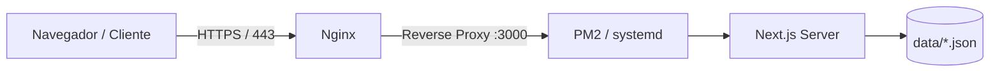

# numa — Plataforma de Gestión Financiera Personal

**numa** es una aplicación web de gestión y control de finanzas personales construida con Next.js 15, TypeScript y Tailwind CSS. Incluye autenticación de dos factores (2FA TOTP RFC 6238), soporte para WebAuthn, sesiones firmadas con HMAC y cifrado AES-256-GCM para credenciales de integraciones externas.

---

## Tabla de Contenidos

1. [Tecnologías](#tecnologías)
2. [Estructura del Proyecto](#estructura-del-proyecto)
3. [Autenticación y Seguridad](#autenticación-y-seguridad)
4. [Persistencia de Datos y Motor Financiero](#persistencia-de-datos-y-motor-financiero)
5. [Despliegue en Producción (PM2 + Nginx)](#despliegue-en-producción-pm2--nginx)
6. [Comandos de Desarrollo y Pruebas](#comandos-de-desarrollo-y-pruebas)
7. [Variables de Entorno](#variables-de-entorno)

---

## Tecnologías

| Componente | Tecnología | Propósito |
| :--- | :--- | :--- |
| **Framework Web** | Next.js 15.2 (App Router, React 19) | Renderizado híbrido, Route Handlers y Edge Middleware |
| **Lenguaje** | TypeScript 5.8 | Tipado estricto (`tsc --noEmit`) |
| **Estilos e Interfaz** | Tailwind CSS 3.4 + Motion | Componentes de interfaz y transiciones |
| **Criptografía y 2FA** | Web Crypto API + RFC 6238 | Tokens de sesión, Base32 y códigos TOTP |
| **Gestión de Procesos** | PM2 / systemd | Ejecución del proceso Node.js en servidor (~70 MB RAM) |
| **Servidor Web y Proxy** | Nginx 1.24+ | Terminación TLS 1.3, Rate Limiting y cabeceras HTTP |
| **Pruebas** | Vitest 5.0 | 125 pruebas unitarias (motor financiero, auth y APIs) |

---

## Estructura del Proyecto

```text
numa/
├── database/                # Esquemas y migraciones Drizzle ORM (PostgreSQL opcional)
│   ├── schema.ts            # Definición relacional de tablas financieras
│   └── seed.ts              # Datos iniciales de prueba
├── docs/                    # Documentación técnica del proyecto
│   ├── architecture.md      # Diagrama y decisiones de arquitectura
│   └── design-system.md     # Guía de componentes y tokens de diseño
├── nginx/                   # Configuración para Nginx Reverse Proxy
│   └── numa.conf            # Virtual host con rate-limiting y cabeceras HTTP
├── public/                  # Recursos estáticos
│   ├── banks/               # Iconos de entidades bancarias y billeteras
│   ├── brand/               # Logotipo e iconos de numa
│   └── emojis/              # Recursos gráficos de categorías
├── scripts/                 # Scripts operativos y de despliegue en servidor
│   ├── deploy-vps.sh        # Script de compilación y despliegue con PM2
│   ├── nginx-personal-finance.conf # Virtual Host para numa.example.com
│   └── personal-finance.service    # Unidad systemd para Linux
├── src/                     # Código fuente de la aplicación
│   ├── app/                 # Rutas y páginas de Next.js (App Router)
│   │   ├── (auth)/          # Grupo de rutas de autenticación
│   │   │   └── login/       # Inicio de sesión en dos pasos (2FA TOTP)
│   │   ├── api/             # Route Handlers del Backend
│   │   │   ├── assistant/   # Consultas al asistente financiero
│   │   │   ├── auth/        # Login, sesión, recuperación y control de accesos
│   │   │   ├── export/      # Exportación a CSV
│   │   │   ├── finance/     # Gestión de cuentas, transacciones y recibos
│   │   │   ├── integrations/# Almacén de credenciales cifradas (AES-256-GCM)
│   │   │   └── telegram/    # Webhook del bot de Telegram
│   │   ├── assistant/       # Vista del asistente
│   │   ├── budgets/         # Presupuestos mensuales
│   │   ├── dashboard/       # Tablero principal de métricas y movimientos
│   │   ├── goals/           # Metas de ahorro
│   │   ├── reports/         # Reportes financieros y flujo de caja
│   │   ├── settings/        # Configuración de cuenta y 2FA
│   │   ├── transactions/    # Historial de transacciones
│   │   ├── layout.tsx       # Layout raíz
│   │   └── not-found.tsx    # Página 404
│   ├── components/          # Componentes de React
│   │   ├── auth/            # Modales de autenticación, 2FA y WebAuthn
│   │   ├── dashboard/       # Tarjetas de cuentas, gráficos y saldos
│   │   ├── finance/         # Formularios de transferencias y transacciones
│   │   ├── layout/          # Barra lateral, cabecera y navegación
│   │   ├── modals/          # Modales de configuración y filtros
│   │   └── ui/              # Componentes base (Botones, Inputs, Badges)
│   ├── lib/                 # Lógica de negocio y utilidades
│   │   ├── auth/            # AuthStore, validación de sesiones y WebAuthn
│   │   ├── database/        # Cliente PostgreSQL opcional
│   │   ├── finance/         # Calculadora en céntimos, servicio financiero y CSV
│   │   ├── gemini/          # Integración con Gemini API y lector de recibos
│   │   ├── security/        # Cifrado AES-256-GCM, TOTP RFC 6238 y rate limit
│   │   ├── telegram/        # Bot grammY, vinculación y deduplicación
│   │   └── validation/      # Esquemas de validación con Zod
│   ├── styles/              # Estilos globales y variables CSS
│   └── middleware.ts        # Edge Middleware de protección de rutas privadas
├── tests/                   # Pruebas automatizadas (Vitest)
│   └── unit/                # 18 suites de pruebas unitarias (125 tests)
├── ecosystem.config.cjs     # Configuración de PM2
├── next.config.ts           # Configuración de Next.js
├── package.json             # Dependencias y scripts
├── tailwind.config.ts       # Configuración de Tailwind CSS
└── tsconfig.json            # Configuración de TypeScript
```

---

## Autenticación y Seguridad

### 1. Flujo de Login en 2 Pasos (TOTP RFC 6238)
- **Paso 1 (Credenciales):** Validación de usuario y contraseña con hash `scrypt` y comparación en tiempo constante.
- **Paso 2 (Verificación TOTP o Enrolamiento):**
  - **Usuario enrolado:** Solicita el código de 6 dígitos de la aplicación autenticadora.
  - **Usuario pendiente (`enrolled: false`):** Muestra el código QR y la clave Base32 para vincular el dispositivo antes de iniciar sesión.

### 2. Registro Público Deshabilitado por Defecto
- Los endpoints [`/api/auth/google`](../src/app/api/auth/google/route.ts) y [`/api/auth/register`](../src/app/api/auth/register/route.ts) devuelven `403 Forbidden` salvo que se habiliten mediante variables de entorno.

### 3. Protección en el Servidor
- **Edge Middleware ([`src/middleware.ts`](../src/middleware.ts)):** Verifica la firma HMAC-SHA256 de la cookie `HttpOnly` `vx_auth_token` en las rutas privadas (`/dashboard`, `/transactions`, `/budgets`, etc.).
- **Validación de Sesión ([`src/lib/auth/server-session.ts`](../src/lib/auth/server-session.ts)):** Los Route Handlers obtienen el usuario desde el token de sesión verificado, evitando accesos cruzados entre cuentas (IDOR).
- **Anti-Replay TOTP:** Impide reutilizar un mismo código TOTP dentro de una ventana de 90 segundos.
- **Sanitización de CSV:** Escapa caracteres iniciales de fórmula (`=`, `+`, `-`, `@`, `\t`, `%`) al exportar transacciones.

---

## Persistencia de Datos y Motor Financiero

1. **Almacenamiento en JSON o PostgreSQL:**
   - Por defecto almacena los datos localmente en `data/auth_store.json` y `data/financial_store.json` (excluidos de Git), con soporte opcional para PostgreSQL mediante Drizzle ORM ([`database/schema.ts`](../database/schema.ts)).
2. **Aritmética en Céntimos:**
   - Para evitar errores de redondeo en coma flotante (IEEE 754), las operaciones se calculan en céntimos enteros en [`src/lib/finance/calculator.ts`](../src/lib/finance/calculator.ts) y se formatean a decimales al presentarse en la interfaz.

---

## Despliegue en Producción (PM2 + Nginx)



### Archivos de Configuración:
1. **[`ecosystem.config.cjs`](../ecosystem.config.cjs):** Ejecuta el proceso en PM2 con reinicio automático si supera los 250 MB de RAM.
2. **[`scripts/nginx-personal-finance.conf`](../scripts/nginx-personal-finance.conf):** Virtual host de Nginx que redirige el tráfico de `numa.example.com` a `http://127.0.0.1:3000`.
3. **[`scripts/deploy-vps.sh`](../scripts/deploy-vps.sh):** Instala dependencias, compila el proyecto y recarga el proceso en PM2.

---

## Comandos de Desarrollo y Pruebas

```bash
# Instalar dependencias
pnpm install

# Servidor de desarrollo (http://localhost:3000)
pnpm dev

# Comprobación de tipos de TypeScript
pnpm check

# Ejecutar las 125 pruebas unitarias
pnpm test

# Compilar para producción
pnpm build
pnpm start
```

---

## Variables de Entorno

En producción, crea `.env.production` a partir de [`.env.production.example`](../.env.production.example) (`chmod 600`):

```ini
NODE_ENV=production
PORT=3000

# Claves de 256 bits (generar con: openssl rand -hex 32)
SESSION_SIGNING_SECRET=cambiar_por_clave_hex_de_64_caracteres
VAULT_MASTER_KEY=cambiar_por_clave_hex_de_64_caracteres

# Opcional
GEMINI_API_KEY=
TELEGRAM_BOT_TOKEN=
TELEGRAM_WEBHOOK_SECRET=
```
