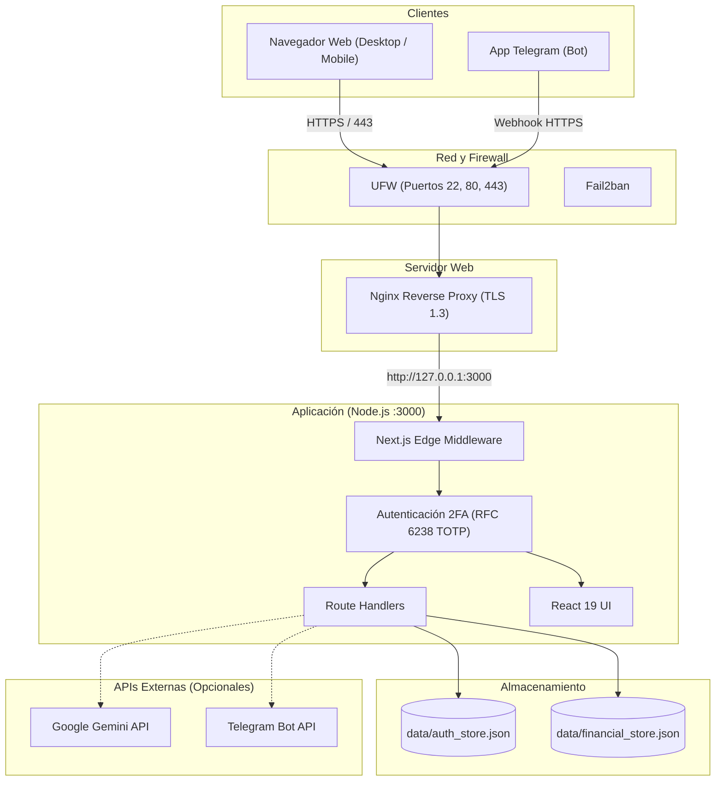

# Arquitectura de la Plataforma — numa

Documentación técnica del diseño del sistema, componentes, almacenamiento y flujo de autenticación.

---

## 1. Visión General del Sistema

**numa** es una aplicación monolítica modular desarrollada en **Next.js 15 (App Router)** y **TypeScript**, configurada para ejecutarse directamente en un VPS Linux con Node.js, PM2/systemd y Nginx (~70 MB de RAM en reposo).

---

## 2. Decisiones de Arquitectura

### 1. Monolito Modular en Next.js
El backend y el frontend comparten modelos de datos, esquemas de validación (Zod) y servicios financieros dentro del mismo proyecto, simplificando el mantenimiento y el despliegue.

### 2. Ejecución Directa con PM2 / systemd y Nginx
- La aplicación se ejecuta directamente sobre Node.js gestionada por PM2 (`ecosystem.config.cjs`) o `systemd` (`scripts/personal-finance.service`).
- Nginx actúa como reverse proxy en el host hacia `127.0.0.1:3000` y gestiona los certificados TLS.

### 3. Persistencia de Datos
- En su configuración por defecto, el almacenamiento reside en archivos JSON dentro del directorio `data/` (excluido del control de versiones):
  - `data/auth_store.json`: usuarios, hashes de contraseña y secretos TOTP.
  - `data/financial_store.json`: cuentas, presupuestos, metas y transacciones.
- Adicionalmente, [`database/schema.ts`](../database/schema.ts) define el esquema relacional en Drizzle ORM para entornos que utilicen PostgreSQL.

### 4. Aritmética Financiera en Céntimos
Para evitar errores de precisión de punto flotante (IEEE 754) en JavaScript:
- Todos los cálculos monetarios (saldos, ingresos, gastos y límites de presupuesto) operan internamente en **céntimos enteros**.
- Los valores se convierten a formato decimal únicamente para su visualización o exportación.

### 5. Autenticación de Dos Pasos (TOTP RFC 6238)
- **Paso 1:** Validación de credenciales con hash `scrypt`.
- **Paso 2:** Verificación TOTP RFC 6238 de 6 dígitos o enrolamiento mediante código QR en el primer acceso.
- **Anti-Replay:** Bloqueo de reutilización del mismo código TOTP durante su ventana de 90 segundos.
- **Exportación CSV segura:** Escapado automático de caracteres iniciales de fórmula (`=`, `+`, `-`, `@`).
